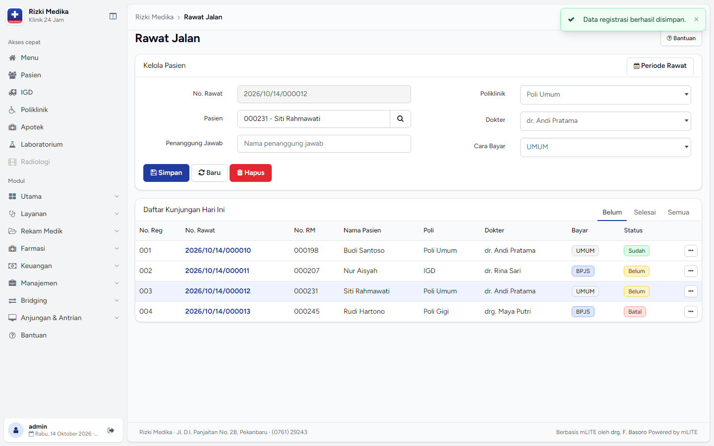
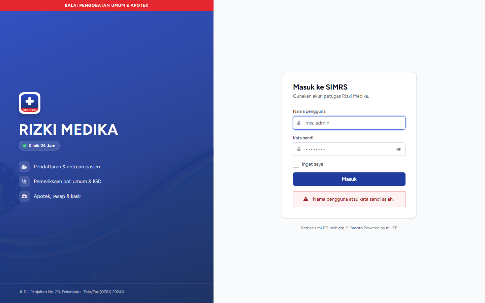
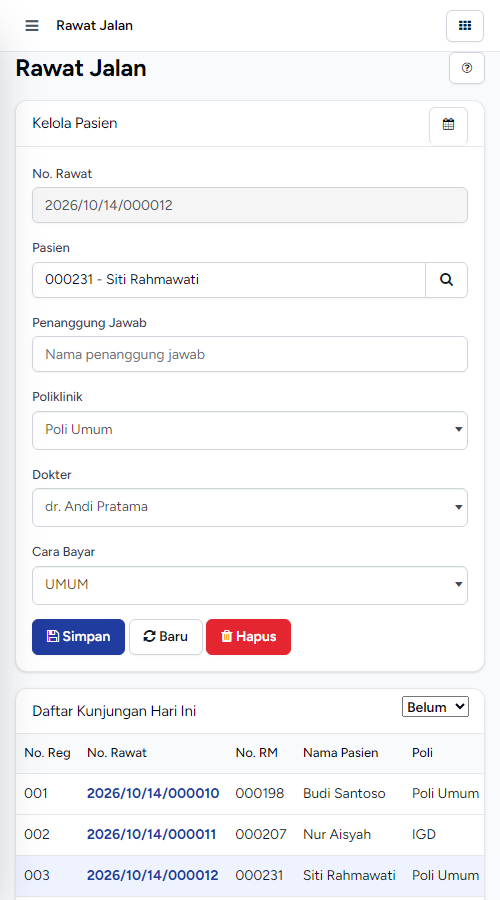

# mLITE: tampilan Rizki Medika (gaya CARE)

Ini overhaul UI untuk **Rizki Medika, Balai Pengobatan Umum & Apotek, Klinik 24 Jam, Pekanbaru**. Gayanya mengikuti design system [CARE](https://github.com/ohcnetwork/care_fe) (MIT), dengan warna dari papan nama klinik: biru sebagai warna utama dan merah sebagai aksen.

**Fungsi tidak berubah.** Logika PHP, URL, nama field form, hak akses, loop menu, modal, dan hook plugin (`$mlite.header` / `$mlite.footer`) semuanya identik dengan aslinya. Yang diganti hanya markup layout dan CSS.

| Desktop | Login | Mobile |
|---|---|---|
|  |  |  |

## Yang berubah

| File | Perubahan |
|---|---|
| `assets/css/rizkimedika.min.css` | **Tema baru** (Bootstrap 3 + override CARE): token warna, tombol, form, panel menjadi card, tabel, label menjadi badge, alert menjadi callout, tab, modal, dropdown, pagination |
| `assets/fonts/figtree/` | Font Figtree (SIL OFL), disimpan lokal sehingga tetap tampil saat offline |
| `themes/admin/index.html` | Shell baru: **sidebar** (akses cepat + 7 grup modul + anjungan) dan konten "inset" dengan breadcrumb. Menggantikan navbar atas dan bar ikon |
| `themes/admin/css/rizkimedika-shell.css`, `js/rizkimedika-shell.js` | Layout sidebar, mode ikon (Ctrl+B), off-canvas di HP, penanda menu aktif |
| `themes/admin/login.html`, `css/rizkimedika-login.css` | Login split: panel brand biru dengan pita merah di kiri, form di kanan. Tetap mendukung OTP WhatsApp |
| `themes/admin/img/logo.png` | Logo monogram sementara. Ganti dengan logo resmi klinik bila ada |
| `plugins/settings/view/admin/general.html` | Menambah pilihan tema "Rizki Medika (CARE)" |
| `docs/rizkimedika/setup.sql` | Identitas klinik dan aktivasi tema |

## Pemasangan

1. Instal mLITE seperti biasa (PHP 7.4+/8.x, MySQL/MariaDB, database Khanza `sik` + `mlite_db.sql`).
2. Jalankan `mysql -u root -p sik < docs/rizkimedika/setup.sql`. Skrip ini mengisi nama, alamat, dan zona waktu WIB, lalu mengaktifkan tema `rizkimedika`. Cara lain: buka **Pengaturan → Umum → Tema Admin → Rizki Medika (CARE)**.
3. Unggah logo resmi lewat **Pengaturan → Logo** bila ada.

## Deploy cloud (operasional)

Server tidak perlu ditaruh di klinik: cukup satu VPS kecil, dan petugas memakai browser/HP. Khanza desktop **tidak** dipakai harian, karena query-nya terlalu banyak untuk lewat internet.

```
Browser/HP petugas ──HTTPS──▶ Caddy (80/443, Let's Encrypt)
                               └─▶ nginx (blokir file sensitif) ─▶ PHP-FPM 8.x (mLITE)
                                                                   └─▶ MySQL 8 (jaringan internal saja)
backup.sh (cron 02:00) ─▶ /var/backups/mlite (terenkripsi) ─▶ object storage offsite (rclone)
```

### Spesifikasi
| | Spesifikasi |
|---|---|
| VPS | **2 vCPU, 4 GB RAM, SSD 60–80 GB**, Ubuntu 24.04, **data center Indonesia** |
| Naik kelas bila | lebih dari 15 pengguna aktif, banyak upload, atau CPU di atas 70% secara rutin → 4 vCPU / 8 GB |
| Lainnya | domain + DNS A-record ke IP VPS, bucket object storage untuk backup, internet klinik + cadangan 4G |

### Langkah
```bash
# di VPS (sebagai root)
git clone https://github.com/satria133/simrizkimedika.git /opt/mlite
cd /opt/mlite/docker
cp .env.production.example .env.production
nano .env.production          # isi DOMAIN, email, password DB, remote & passphrase backup
rclone config                 # buat remote object storage (sesuai BACKUP_REMOTE)
bash deploy.sh                # Docker, firewall, hardening, container, password admin, cron backup
```
Saat database pertama kali dibuat, `mlite_db.sql` dan `docs/rizkimedika/setup.sql` diimpor otomatis, sehingga tema dan identitas Rizki Medika langsung aktif. Password `admin` yang baru tersimpan di `/root/mlite-admin-awal.txt`. Segera login, ganti password, buat akun per petugas sesuai role, lalu hapus file itu.

Update aplikasi: `git pull && bash deploy.sh`.

### Keamanan yang sudah diatur
- Hanya port 22/80/443 yang terbuka. MySQL tidak pernah di-publish.
- `docker/nginx/prod.conf` memblokir `.env`, `.git`, `*.sql`, `docker/`, `systems/`, `vendor/`, `backups/`, `install.php`, `config.php`, dan file PHP di `uploads/` (sudah diuji: semuanya 404, aset tema 200).
- `DEV_MODE` dipaksa `false`. Bawaan mLITE adalah `true` bila tidak diset, yang akan menampilkan error ke pengguna.
- HTTPS dengan HSTS. Header `X-Forwarded-Proto` diteruskan ke PHP agar semua link memakai `https`.
- SSH hanya dengan key (bila key sudah terpasang), `fail2ban`, dan update keamanan otomatis.
- Disarankan: aktifkan **OTP WhatsApp** login mLITE di Pengaturan.

### Backup & restore
- `docker/backup.sh` berjalan tiap hari pukul 02:00: dump database + `uploads/`, dienkripsi AES-256 (gpg), disimpan lokal 7 harian / 4 mingguan / 12 bulanan, lalu dicerminkan ke offsite.
- Pulihkan dengan `bash docker/restore.sh /var/backups/mlite/harian/mlite-YYYY-MM-DD.tar.gz.gpg`. **Uji restore sebulan sekali.**
- Simpan `BACKUP_PASSPHRASE` di luar server. Tanpa passphrase ini backup tidak bisa dibuka.

### Integrasi
Isi kredensial **BPJS PCare/Antrean FKTP** dan **SatuSehat** di Pengaturan mLITE (disediakan klinik). Uji dulu di sandbox.

## Rollback

- **Warna saja:** pilih tema admin lain di Pengaturan. Shell sidebar tetap rapi dengan tema Bootswatch mana pun.
- **Semuanya:** `git checkout master -- themes/admin plugins/settings/view/admin/general.html`

## Catatan teknis

- Bootstrap 3 menetapkan `html { font-size: 10px }`, jadi ukuran shell sengaja ditulis dalam `px`, bukan `rem`.
- `style.css` bawaan tetap dimuat. Aturan lamanya (`#content-wrapper` absolut, `footer` fixed, `#notify` bar penuh) dinetralkan di `rizkimedika-shell.css`.
- Hasil verifikasi: template dirender dengan engine `Systems\Lib\Templates` asli dan data contoh, lalu di-screenshot di 1440px, 1280px (tema flatly), dan 500px (mobile). Tidak ada overflow horizontal. Semua URL di template baru sama dengan template asli (dicek dengan `diff`).
